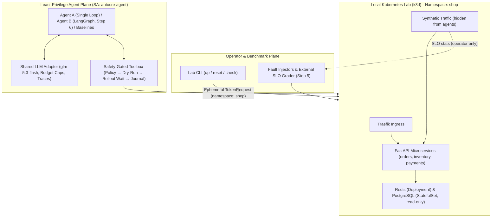

# AutoSRE

**AutoSRE** is an ongoing bachelor's thesis engineering project evaluating how reliably LLM agents diagnose and remediate Kubernetes microservice incidents when restricted to a least-privilege toolbox, benchmarked against scripted baselines under controlled experimental parity.

> **Why is the source code private?**
> The full implementation lives in a private repository while the thesis is in progress and will be published publicly after submission and defense (planned early 2027). This repository mirrors verified architecture and milestone progress.

---

## System Overview

---

## Key Engineering Highlights

- **Least-Privilege Toolbox (No Shell / No `exec`):** Agents authenticate via short-lived, in-memory Kubernetes `TokenRequest` tokens scoped to namespace `shop` (no `Secrets`, read-only `StatefulSets`, no cluster-wide permissions). Every mutation passes Pydantic schema validation, policy bounds, `resourceVersion`-guarded JSON Patch, server-side dry-run, bounded rollout wait, and append-only audit journaling.
- **Controlled 2 × 2 + Baselines Evaluation:** Compares a single-agent loop (`A`) and a role-separated LangGraph workflow (`B`), each with and without local runbook RAG, against 4 scripted baselines (`No-op`, `Restart-all`, `Rollback`, `Oracle`) across 9 fault scenarios (including compound incidents, a healthy control, and policy-restricted database escalation). All LLM configurations share one client (`max_retries=0`, code-pinned parameters, preserved thinking replay), one tool catalog, and one per-incident budget.
- **External Grading & Measurement Isolation:** Recovery is judged externally against steady-state synthetic traffic (`loadgen`), which is excluded from agent read tools and blocked from mutations so agents cannot tamper with or observe the grading instrument.
- **Reproducible Lab & CI:** One-command `k3d` cluster bootstrap/reset with hash-pinned service dependencies, digest-verified container image imports, and cross-platform CI (`Ubuntu` + `Windows`: `pytest`, `mypy --strict`, `ruff`, Docker builds, and Kustomize rendering).

---

## Progress Tracker

*Last synced with private repository: **2026-11-25**.*

| Step | Milestone | Status | Summary |
|---|---|---|---|
| **1** | Setup, CI & LLM Tool-Calling Check | **Done** | Pinned `uv` toolchain, Ubuntu + Windows CI, `autosre doctor` live tool-calling round-trip |
| **2** | Fault-Injectable Kubernetes Lab | **Done** | 3 FastAPI services, PostgreSQL, Redis, synthetic traffic, Kustomize manifests, one-command `lab up / check / reset`, baseline steady-state SLO |
| **3** | Least-Privilege Toolbox & Agent `A0` | **In Progress** | Dual-identity K8s client, read/mutate toolbox, policy/dry-run/journal, budget accounting, `A0` loop, and 147 unit tests passing in CI; finalizing RBAC live verification & live gate runs |
| **4** | Observability & Alert Webhook | **Planned** | Prometheus, Alertmanager, Grafana (Helm), SLO/crash/OOM alert rules, `query_metrics` tool, webhook trigger |
| **5** | Benchmark Harness & Baselines | **Planned** | 9 scenario cards, fault injectors, external SLO grader, non-LLM baselines (`N0`–`N3`), calibration runs |
| **6** | Multi-Agent Graph (`B0`) | **Planned** | Role-separated LangGraph `StateGraph` (Diagnostician, Approval Interrupt, Remediator, Verifier) under strict parity with `A0` |
| **7** | Runbook RAG, Pilot & Freeze | **Planned** | Local vector index (`search_runbooks`), retrieval evaluation, full pilot, protocol freeze |
| **8** | Main Benchmark & Analysis | **Planned** | Resumable seeded benchmark matrix, scripted statistical tables/charts (Wilson 95% CIs, median/IQR) |
| **9–10** | Thesis Defense & Public Release | **Planned** | Final submission, defense demo, and public release of full source code |

---

## Tech Stack

- **Implemented (Steps 1–3):** Python 3.12, FastAPI, PostgreSQL, Redis, Kubernetes (`k3d` / `k3s`), Kustomize, Docker, `kubernetes` Python client, OpenAI SDK (Z.ai `glm-5.3-flash`), Pydantic v2, Typer, `uv`, `pytest`, `mypy --strict`, `ruff`, GitHub Actions.
- **Planned (Steps 4–8):** Prometheus, Alertmanager, Grafana, Helm, LangGraph, local vector search (runbook RAG).

---

## Contact

For technical inquiries or a private walk-through while the thesis repository remains closed: **democritushygge@gmail.com**
